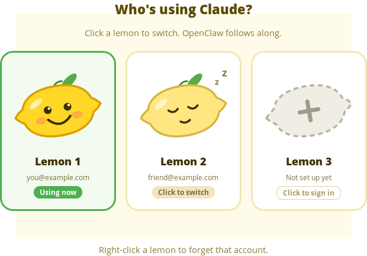

# Lemon Switcher

Click a lemon to switch which Claude Code account this computer uses. OpenClaw
switches along with it.



Built for three people sharing one Linux machine. Each person signs in to
their own Claude account once, and after that handing over is one click.

## How it works

OpenClaw runs Claude through the `claude` command (the `claude-cli` agent
runtime), so it always uses whatever account Claude Code is signed into.
Switching does three things:

1. Saves the current person's login, including any refreshed tokens.
2. Puts the next person's login in `~/.claude/.credentials.json` and
   `~/.claude.json`.
3. Restarts `openclaw-gateway.service` so OpenClaw's agents start up on the
   new account.

Saved logins live in `~/.claude-accounts/`, which only your user can open.

## Install

Needs Python 3 with GTK 3 (`python3-gi`). Pop!_OS and Ubuntu include it by default.

```bash
./install.sh
```

This puts `lemon-switcher` and `claude-switch` in `~/.local/bin` and adds
**Lemon Switcher** to your app menu.

## Use

- **Grey lemon with a plus**: no account yet. Click it, then either save the
  account that's signed in now, or sign someone else in through a terminal
  (`/login`, then `/exit`).
- **Sleepy lemon**: a saved account. Click it to switch.
- **Happy lemon**: the account in use right now.
- **Right-click** a lemon to forget that account.
- The **bar** under each lemon shows how much of that person's 5-hour usage
  limit is left, and when it resets. It updates every minute. A faded bar is
  the last known reading: a saved login's token expires a few hours after that
  person last used it, and the switcher won't refresh it for them.
- **Auto-switch** (the toggle under the lemons): when the lemon in use has less
  than 2% of its 5-hour limit left, the switcher moves to the lemon with the
  most left (if that's at least 10%) and shows a notification. The window
  checks every minute while it's open, and a background timer
  (`lemon-autoswitch.timer`, added by `install.sh`) checks every 3 minutes
  even when it's closed. Turn it off with the toggle or
  `claude-switch auto off`.

Wait until OpenClaw's agents are idle before switching: the restart stops
anything that's running. Afterwards, close and reopen any Claude Code windows.

### Terminal version

```
claude-switch                 interactive menu
claude-switch list            show saved accounts (* = active)
claude-switch add NAME        sign a new person in and save them as NAME
claude-switch save NAME       save whoever is signed in right now as NAME
claude-switch use NAME        switch to NAME
claude-switch remove NAME     forget a saved account
claude-switch restart         restart OpenClaw on the current account
claude-switch usage           show each account's 5-hour usage left
claude-switch auto [on|off]   show or set auto-switching when a limit is reached
claude-switch auto check      auto-switch now if the active account is out
```

## Fair use

Each person should only ever use their own Claude account. This tool lets
people take turns on a shared computer; it is not for sharing one login.
